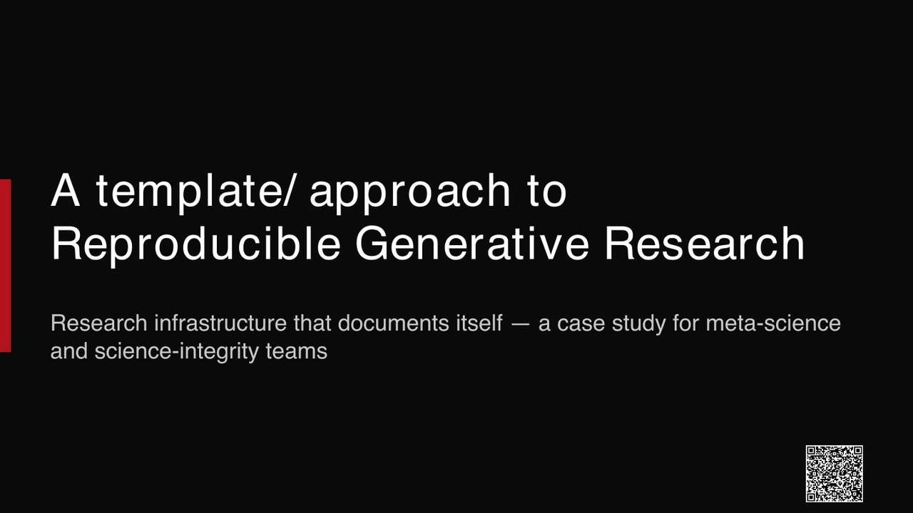

# Template: Pitch Deck

Reproducible, validated pitch-deck generation — one token-resolved content
source renders to six real artifacts: short/medium/long decks, each as both
PDF and PPTX.

**Location:** git-tracked public exemplar at `projects/templates/template_pitch_deck/`
in the [`docxology/template`](https://github.com/docxology/template) checkout. This
standalone repository is that directory published as its own repo — its root **is**
the project directory, so `projects/templates/.../` paths below are monorepo-relative.

## When to use this template

Use this template when you need a pitch, grant report, or recurring
stakeholder update treated as a build artifact — bound to live repository
facts, validated for unresolved tokens and pitch-deck cliché, and
regenerable byte-for-byte from source rather than hand-maintained in a
proprietary slide tool. The flagship shipped content pitches
`projects/templates/template_template/` — the monorepo's own
autopoietic meta-project — to a meta-science / science-integrity audience.

If your research subject renders as a manuscript instead, start from
`projects/templates/template_code_project/` or
`projects/templates/template_template/` (monorepo-relative sibling paths; not
present in this standalone checkout). Full roster: `projects/AGENTS.md` in the
monorepo.

## Publication and rendering

<!-- PUBLISHING-STATUS:START (generated by infrastructure.publishing.status_report) -->
**template_pitch_deck: Reproducible, Validated Pitch-Deck Generation** · v1.0.0 · MIT · Daniel Ari Friedman

Concept DOI: [10.5281/zenodo.21281509](https://doi.org/10.5281/zenodo.21281509) | Version DOI: [10.5281/zenodo.21281510](https://zenodo.org/records/21281510) | Repository: [docxology/template-pitch-deck](https://github.com/docxology/template-pitch-deck)

Publishing surface — 20 platforms, 2 published:

| Platform | Tier | Status | Reference | Credentials |
| --- | --- | --- | --- | --- |
| zenodo | first-class | ✅ published | [10.5281/zenodo.21281509](https://doi.org/10.5281/zenodo.21281509) | `ZENODO_API_TOKEN` |
| github | first-class | ✅ published | [docxology/template-pitch-deck](https://github.com/docxology/template-pitch-deck) | `GITHUB_TOKEN` |
| arxiv | first-class | ⚪ available | — | — |
| pypi | first-class | ⚪ available | — | `PYPI_TOKEN`, `TESTPYPI_TOKEN` |
| ipfs_pinata | first-class | ⚪ available | — | `PINATA_JWT` |
| ipfs_web3storage | first-class | ⚪ available | — | `WEB3_STORAGE_TOKEN` |
| software_heritage | first-class | ⚪ available | — | — |
| github_pages | first-class | ⚪ available | [docxology/template-pitch-deck](https://github.com/docxology/template-pitch-deck) | `GITHUB_TOKEN` |
| cloudflare_pages | first-class | ⚪ available | — | `CLOUDFLARE_API_TOKEN` |
| netlify | first-class | ⚪ available | — | `NETLIFY_AUTH_TOKEN` |
| huggingface_hub | first-class | ⚪ available | — | `HUGGINGFACE_TOKEN`, `HF_TOKEN` |
| osf | first-class | ⚪ available | — | `OSF_TOKEN` |
| amazon_kdp | documented | 🟡 planned | — | `AMAZON_KDP_EMAIL`, `AMAZON_KDP_PASSWORD` |
| google_play_books | documented | 🟡 planned | — | `GOOGLE_PLAY_BOOKS_SERVICE_ACCOUNT_JSON` |
| gumroad | documented | 🟡 planned | — | `GUMROAD_ACCESS_TOKEN` |
| leanpub | documented | 🟡 planned | — | `LEANPUB_API_KEY` |
| lulu | documented | 🟡 planned | — | `LULU_CLIENT_KEY`, `LULU_CLIENT_SECRET` |
| draft2digital | documented | 🟡 planned | — | `DRAFT2DIGITAL_API_TOKEN` |
| stripe | documented | 🟡 planned | — | `STRIPE_SECRET_KEY`, `STRIPE_PUBLISHABLE_KEY` |
| ingramspark | documented | 🟡 planned | — | `INGRAMSPARK_CLIENT_ID`, `INGRAMSPARK_CLIENT_SECRET` |

_Keywords: pitch deck, slide generation, reproducible research communication, meta-science infrastructure, science integrity, token validation, PPTX, PDF rendering._

_Status legend: ✅ published (durable identifier recorded in `config.yaml`) · 🔵 reserved (identifier reserved but not yet registered by final publication) · ⚪ available (adapter implemented and locally verifiable) · 🟡 planned. This block is generated — edit `docs/manuscript/config.yaml`, then regenerate with `uv run python -m infrastructure.publishing.status_report --project <path> --write`._
<!-- PUBLISHING-STATUS:END -->

## Build and author

See the [documentation index](docs/README.md), [pinned build workflow](docs/build.md),
and [authoring guide](docs/authoring.md). The [canonical manuscript](docs/manuscript/)
contains the two subjects' slide sources, the descriptive paper, and its bibliography.

The tracked [output snapshot](output/) contains release artifacts. A fresh local
build uses the selected reference checkout's evidence and generates its own
PDF, PPTX, manuscript HTML, and per-slide Markdown pages.
